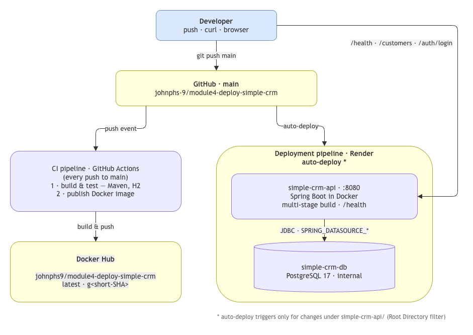
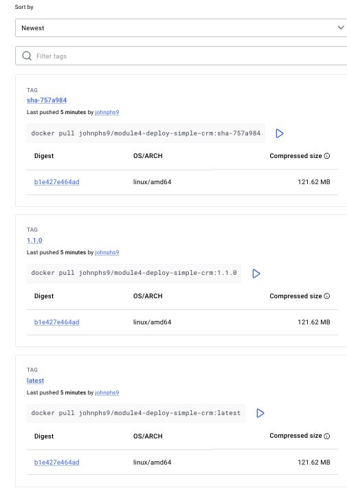
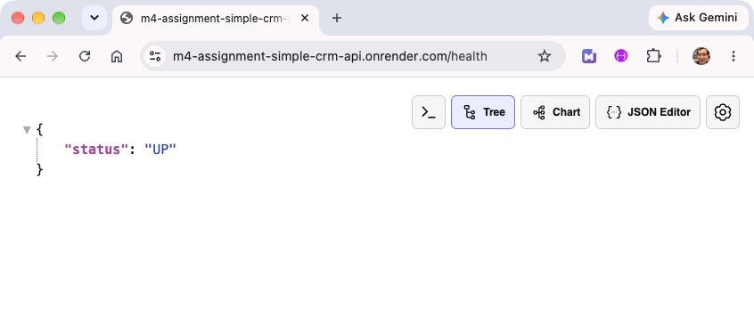
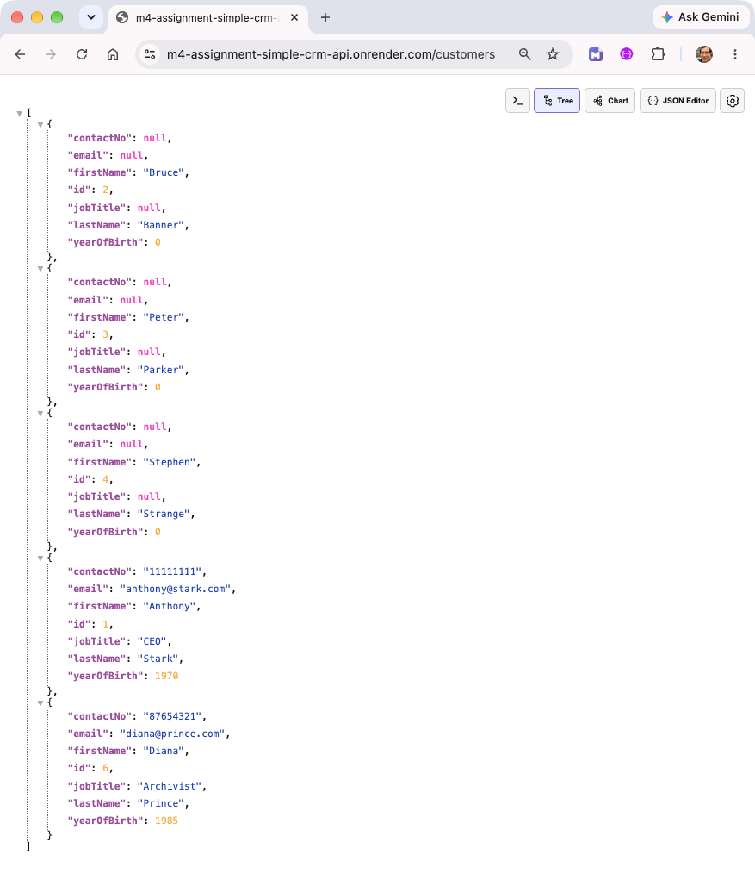
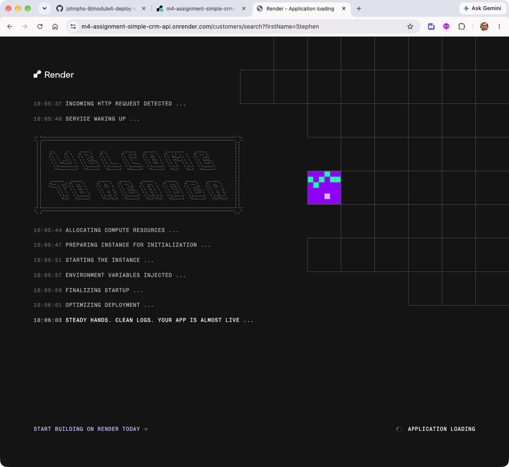
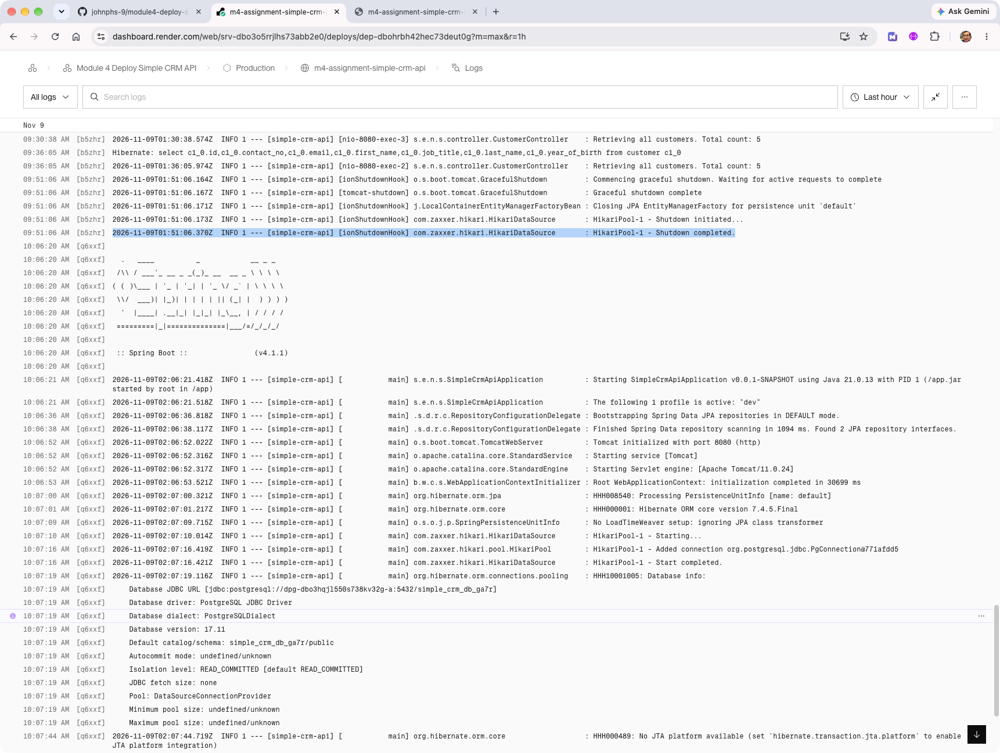
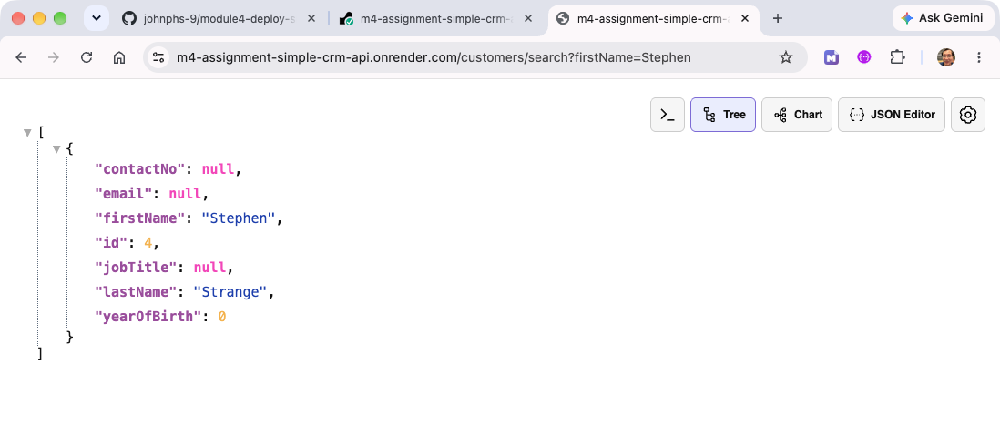
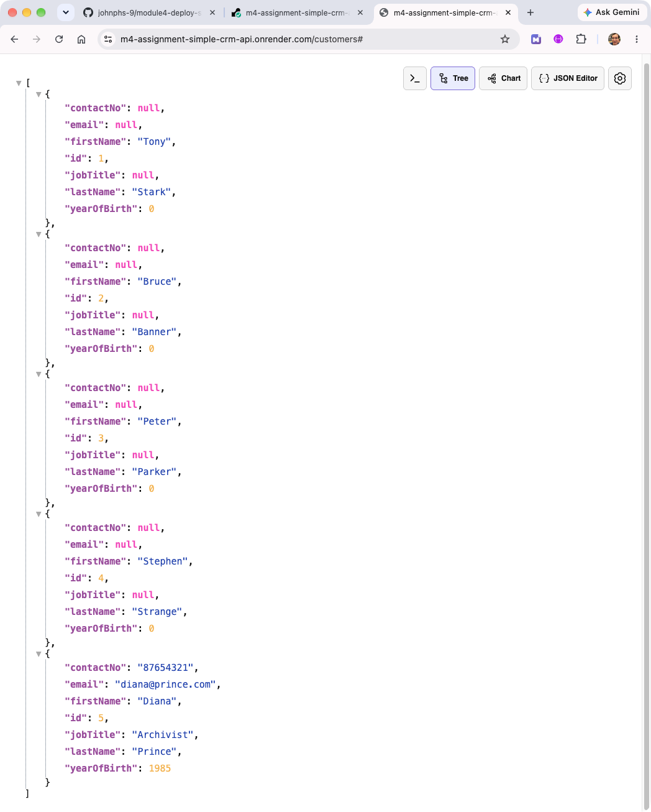

# Module 4 Assignment — Dockerize & Deploy (Simple CRM API, Render)

I completed Tasks 1–4 (_"Baseline"_) using my **Simple CRM API** (Stretch Option 3 backend) instead of TaskFlow, deployed on Render as allowed for free accounts.

## Submission scope

| Area | Scope | Status |
| --- | --- | --- |
| Simple CRM API | Spring Boot / Java API combining all Module 3 lessons (excluding Spring AI), 4.1 and 4.2. | ✅ Baseline |
| Earlier assignments | Assignments `3.19 - unit and integration testing`, `4.1 - secure software development & authentication Pt 1` and `4.2 - secure software development & authentication Pt2` are rolled into the API. | ✅ Baseline |
| Module 4 assignment | **Tasks 1–4**: create a Dockerfile, build and test locally, deploy, and verify the deployment using the Simple CRM API instead of TaskFlow. **Deployed on Render**.| ✅ Baseline |
| Stretch Option 1 — Add a CI Pipeline | Build, test and publish the API image to Docker Hub using GitHub Actions, alongside the Render deployment. | ✅ Complete |
| Stretch Option 3 — Use your Simple CRM project | Containerized and deployed the API with PostgreSQL. The React frontend deployment and integration are not included. | ✅ Partial (no Simple CRM frontend) |
| Stretch Option 4 — Publish Versioned Docker Images | SemVer (`MAJOR.MINOR.PATCH`) release tags sourced from the root `VERSION` file, immutable `sha-<short-SHA>` tags, and `latest` always pointing at the newest build — published to Docker Hub with the tags-page screenshot below. | ✅ Complete |

## Backend Deployed

**API URL (Render)**: https://m4-assignment-simple-crm-api.onrender.com

**GitHub**: https://github.com/johnphs-9/module4-deploy-simple-crm

### Simple CRM API architecture



---

## Stretch Option 1 — add a CI pipeline to Docker Hub (GitHub Actions)

A GitHub Actions CI pipeline (`.github/workflows/docker.yml`) to run on **every push to `main`**. 
- CI pipeline to Docker Hub and the Render deployment pipeline work side by side.
- Auto-deploy on Render triggers only for changes under simple-crm-api/ (Root Directory filter); docs-only pushes intentionally skip redeploy. 

| Pipeline | Trigger | What it does |
| --- | --- | --- |
| **CI pipeline** (GitHub Actions) | push to `main` | Builds with Maven → runs all unit & integration tests (H2 in-memory, no DB needed in CI) → on test success builds the Docker image (`simple-crm-api/` context) and pushes it to Docker Hub |
| **Deployment pipeline** (Render) | push to `main` | Builds the Dockerfile and deploys the web service on Render |

### Pipeline design

- **Job 1 — `test`:** `actions/checkout` → `actions/setup-java` (Temurin 21, Maven cache) → `./mvnw -B clean install` (tests use the `test` profile backed by an H2 in-memory database).
- **Job 2 — `publish`:** runs only if tests pass (`needs: test`) → `docker/login-action` authenticated with GitHub repository **secrets**.
- **Docker Hub credentials** are stored as GitHub repository secrets — never committed to code.

- **Image tags configured for each successful publish:**
  - `johnphs9/module4-deploy-simple-crm:latest` — always points at the newest passing build,
  - `johnphs9/module4-deploy-simple-crm:sha-<short-SHA>` — one immutable tag per commit for traceability/rollback.

### Verification

- First successful pipeline run (GitHub Actions): [#42773145649](<https://github.com/johnphs-9/module4-deploy-simple-crm/actions/runs/42773145649>)

- Image on Docker Hub: <https://hub.docker.com/r/johnphs9/module4-deploy-simple-crm/tags>

---

## Stretch Option 4 — publish versioned Docker images (SemVer + Git SHA)

Images are published with **Semantic Versioning (MAJOR.MINOR.PATCH, Lesson 4.5)** instead of only `latest`, plus the immutable commit-SHA tag already introduced in Option 1. All tags live on <https://hub.docker.com/r/johnphs9/module4-deploy-simple-crm/tags>.

### Versioning scheme

| Tag | Meaning | Rule |
| --- | --- | --- |
| `MAJOR.MINOR.PATCH` (e.g. `1.1.0`) | Release version | Source of truth = the `VERSION` file at the repo root; a **MINOR** bump marks a new feature, a **PATCH** bump a fix/docs change, a **MAJOR** bump a breaking change |
| `sha-<short-SHA>` (e.g. `sha-281b303`) | Immutable build pointer | One per commit, never moved — used for traceability and rollback |
| `latest` | Newest passing build | Always points at the image built from the most recent successful `main` push |

How the CI enforces it (`.github/workflows/docker.yml`):
- The `publish` job reads the first `MAJOR.MINOR.PATCH` line from the root `VERSION` file and tags the image with it.
- If `VERSION` is missing or malformed the pipeline **fails** with an error — no unversioned image can ever be published by accident.
- Each push to `main` therefore publishes three tags: `latest` (moving), `<version>` (release) and `sha-<short-SHA>` (immutable).

- Tag-convention note: builds pushed before this prefix was standardised keep their legacy `g<short-SHA>` names (`ge82266a`, `gae2bd82`, `gdfbc582`, `g281b303`) — same meaning (immutable per-commit pointer), older format.

Per-version change details: [CHANGELOG.md](CHANGELOG.md).

### Version history

| Version | What changed | How it was published |
| --- | --- | --- |
| `1.0.1` | JWT login fix — all three accounts can obtain a JWT | Local build only (pre-Docker Hub) |
| `1.0.2` | `BasicAuthenticationEntryPoint` fix — browser shows native login prompt | Local build → pushed manually |
| `1.0.3` | Customer data preserved across service restarts | Local build → pushed manually |
| `1.0.4` | Stretch Option 1 complete: CI pipeline to Docker Hub | CI build `gdfbc582` retagged as `1.0.4` on Docker Hub |
| `1.1.0` | Stretch Option 4: SemVer tagging added to the CI pipeline (MINOR bump — new CI feature) | **Automatically** by CI from the `VERSION` file |

`latest` = the newest version (`1.1.0` and onwards is always the newest published build).

### Verification

- Docker Hub tags (live): <https://hub.docker.com/r/johnphs9/module4-deploy-simple-crm/tags>
- Successful CI run publishing `1.1.0` + `latest` + `g281b303`: [#42811181947](<https://github.com/johnphs-9/module4-deploy-simple-crm/actions/runs/42811181947>)



---

## Spring Security for Simple CRM API 

### Authentication and Authorisation (RBAC)

| Request | user | manager | admin |
|---|---|---|---|
| username | _user_ | _manager_ | _admin_ |
| password | _user123_ | _manager123_ | _admin123_ | 
| GET `/customers` | ✅ 200 | ✅ 200 | ✅ 200 |
| GET `/customers/{id}` | ✅ 200 | ✅ 200 | ✅ 200 |
| POST `/customers` | ❌ 403 | ❌ 403 | ✅ 201 |
| PUT `/customers/{id}` | ❌ 403 | ✅ 200 | ✅ 200 |
| DELETE `/customers/{id}` | ❌ 403 | ❌ 403 | ✅ 200 |

### Suggested shell variables to set (export) for manual testing using curl

```text
APP_USER_USERNAME=user
APP_USER_PASSWORD=user123
APP_ADMIN_USERNAME=admin
APP_ADMIN_PASSWORD=admin123
APP_MANAGER_USERNAME=manager
APP_MANAGER_PASSWORD=manger123

BASE="https://m4-assignment-simple-crm-api.onrender.com"

TOKEN="<token string xxx.yyy.zzz (JWT bearer token format) from successful login>"
```

---

## API Reference (all implemented endpoints)

Base URL: `https://m4-assignment-simple-crm-api.onrender.com` (dev profile). 

The app uses **two complementary auth mechanisms**:

| Mechanism | Where it applies | How to authenticate |
|-----------|------------------|---------------------|
| **HTTP Basic** (Assignment 4.1) | everything else (`/customers/**`, health) | `-u <user>:<pass>` — curl flag or `Authorization: Basic ...` header |
| **JWT Bearer** (Assignment 4.2) | `POST /auth/login` issues the token; `GET /api/**` requires it | `Authorization: Bearer <TOKEN>` header |

**In-memory users**: 
- `user` → `ROLE_USER`
- `manager` → `ROLE_MANAGER`
- `admin` → `ROLE_ADMIN`

All three accounts can obtain a JWT at `POST /auth/login`

### Endpoint summary

| Method | Path | Auth | Roles | Success | curl |
|--------|------|------|-------|---------|:-------|
| `GET` | `/health` | **none (public)** | — | 200 `{"status":"UP"}` | `curl $BASE/health` |
| `POST` | `/auth/login` | **none (public)** | — | 200 `{"token":"…"}`, 401 on bad/missing credentials | `curl -X POST $BASE/auth/login -H 'Content-Type: application/json' -d '{"username":"user", "password":"user123"}'` |
| `GET` | `/api/hello` | JWT | ANY | 200 plain string | `curl $BASE/api/hello -H "Authorization: Bearer $TOKEN"` |
| `GET` | `/customers` | Basic | ANY | 200 JSON array | `curl $BASE/customers -u manager:manager123` |
| `GET` | `/customers/{id}` | Basic | ANY | 200, 404 if not found | `curl $BASE/customers/1 -u user:user123` |
| `GET` | `/customers/search?firstName=…` | Basic | ANY | 200 JSON array, exact-match on first name | `curl "$BASE/customers/search?firstName=Stephen" -u user:user123` |
| `GET` | `/customers/search/job?jobTitle=…` JPQL exact-match on job title | Basic | ANY | 200 JSON array | `curl "$BASE/customers/search/job?jobTitle=CEO" -u user:user123` |
| `POST` | `/customers` | Basic | ADMIN | 201 created customer, 400 on validation errors  | `curl -i -X POST $BASE/customers -u admin:admin123 -H 'Content-Type: application/json' -d '{"firstName":"Diana","lastName":"Prince","email":"diana@prince.com","contactNo":"87654321","jobTitle":"Archivist","yearOfBirth":1985}'`|
| `PUT` | `/customers/{id}` | Basic | MANAGER, ADMIN | 200 updated customer, full replace; 404 if not found | `curl -i -X PUT $BASE/customers/1 -u admin:admin123 -H 'Content-Type: application/json' -d '{"firstName":"Anthony","lastName":"Stark","email":"anthony@stark.com","contactNo":"11111111","jobTitle":"CEO","yearOfBirth":1970}'`|
| `DELETE` | `/customers/{id}` | Basic | ADMIN | 204 no body, 404 if not found | `curl -i -X DELETE $BASE/customers/5 -u admin:admin123` |
| `POST` | `/customers/{id}/interactions` | Basic | ADMIN | 201 created interaction, 404 if customer missing | `curl -i -X POST $BASE/customers/1/interactions -u admin:admin123 -H 'Content-Type: application/json' -d '{"remarks":"Followed up on project requirements","interactionDate":"2026-11-01"}'` |

- Unauthenticated requests → **401** with a `WWW-Authenticate: Basic realm="Realm"` challenge header → Chrome/Firefox pops up a native login dialog.

- Authenticated but not authorised → **403**.

### Data Refresh Logic

- The `dev` profile is set for update (`spring.jpa.hibernate.ddl-auto=update`). Tables and data are persistent across deployments and restarts. 

- `DataLoader` seeds four customers at service startup only if customer repository is empty — **Tony Stark, Bruce Banner, Peter Parker, Stephen Strange** (names only; no email/job title). 

**Note**: customer ID sequence is not guaranteed when seeding an empty table in an existing database.

### Customer JSON shape

```json
{
  "id": 1,
  "firstName": "Tony",
  "lastName": "Stark",
  "email": "tony@stark.com",
  "contactNo": "12345678",
  "jobTitle": "Engineer",
  "yearOfBirth": 1970
}
```

Validation (enforced server-side, returns 400): 
- `firstName` and `lastName` are mandatory (non-blank)
- `email` must be a valid email format 
- `contactNo` must be exactly 8 characters,
- `jobTitle` must be 2–50 characters.

---

## Screenshots

### Render Dashboard


### Webservice and PostgreSQL deployed successfully

- A successful `push main` to GitHub automatically triggers a docker build in Render.


- logs showing simple-crm-api deployed successfully and serving requests - performing CRUD operations on the database.


### Health Check service (no authentication required)



### Browser native login prompt

- When a protected endpoint is requested without valid credentials, the API returns a 401 Unauthorized response with a Basic authentication challenge. 
- The browser then displays its native login prompt.


### Live API 

- Endpoint: [GET /customers](https://m4-assignment-simple-crm-api.onrender.com/customers)
- Browser then supplies the previously collected credentials in an `Authorization: Basic` header on subsequent requests.



### Service waking 

- Render will spin down instances for free tier accounts after a period of inactivity (~15 minutes).    

- Render automatically restarts the service upon incoming requests. The entire waking up process may take up to 2 minutes as both web and database services are brought up. 



- Logs showing service successfully brought up. 



- Response from API as expected after service running again.



- Database data remains persisted across deployments and service restarts.


