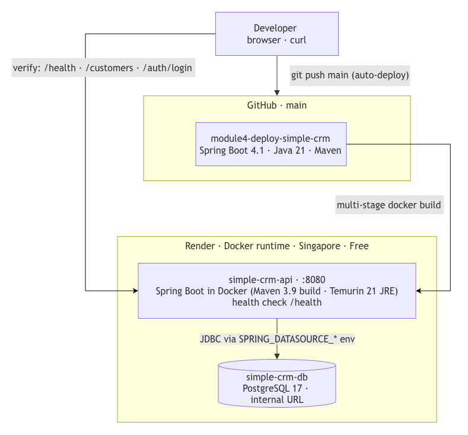

# Module 4 - Deploy Simple CRM

## Objective
1. simple-crm-api is a Spring Boot 4.1.1 / Java 21 course project that **rolls up every lesson in Module 3** (excluding Spring AI), plus Assignments **3.19, 4.1 and 4.2** (unit and integration testing, secure software development & authentication, PT1 and PT2), built on top of the earlier `simple-crm` REST API.
2. End of module assignment project to dockerize & deploy to Render.

## Backend - Deployed

**API URL (Render)**: https://m4-assignment-simple-crm-api.onrender.com

**GitHub**: https://github.com/johnphs-9/module4-deploy-simple-crm



**Health Check service at /health** (no authentication required)


---

## Spring Security 

### Authentication and Authorisation (RBAC)

| Request | user | manager | admin |
|---|---|---|---|
| username | _user_ | _manager_ | _admin_ |
| password | _user123_ | _manager123_ | _admin123_ | 
| GET `/customers` | ✅ 200 | ✅ 200 | ✅ 200 |
| GET `/customers/{id}` | ✅ 200 | ✅ 200 | ✅ 200 |
| POST `/customers` | ❌ 403 | ❌ 403 | ✅ 201 |
| PUT `/customers/{id}` | ❌ 403 | ✅ 200 | ✅ 200 |
| DELETE `/customers/{id}` | ❌ 403 | ❌ 403 | ✅ 200 |

### Example of shell variables to set (export) for manual testing using curl

```text
APP_USER_USERNAME=user
APP_USER_PASSWORD=user123
APP_ADMIN_USERNAME=admin
APP_ADMIN_PASSWORD=admin123
APP_MANAGER_USERNAME=manager
APP_MANAGER_PASSWORD=manger123

BASE="https://m4-assignment-simple-crm-api.onrender.com"
```

---

## API Reference (all implemented endpoints)

Base URL: `https://m4-assignment-simple-crm-api.onrender.com` (dev profile). The app uses **two complementary auth mechanisms**:

| Mechanism | Where it applies | How to authenticate |
|-----------|------------------|---------------------|
| **JWT Bearer** (Assignment 4.2) | `POST /auth/login` issues the token; `GET /api/**` requires it | `Authorization: Bearer <TOKEN>` header |
| **HTTP Basic** (Assignment 4.1) | everything else (`/customers/**`, health) | `-u <user>:<pass>` — curl flag or `Authorization: Basic ...` header |

In-memory users: `user`/`user123` → `ROLE_USER`, `manager`/`manager123` → `ROLE_MANAGER`,
`admin`/`admin123` → `ROLE_ADMIN`. All three accounts can obtain a JWT at `POST /auth/login`
(credentials configured via `app.auth.*` in `.env`); the token carries no role claim —
`JwtAuthFilter` maps the subject to the RBAC role above, so an admin Bearer token can
call the ADMIN-only endpoints too. HTTP Basic remains available on `/customers/**`.

### Endpoint summary

| Method | Path | Auth | Roles | Success | Notes |
|--------|------|------|-------|---------|-------|
| `GET` | `/health` | **none (public)** | — | 200 `{"status":"UP"}` | `curl $BASE/health` |
| `POST` | `/auth/login` | **none (public)** | — | 200 `{"token":"…"}`, 401 on bad/missing credentials |  |
| `GET` | `/api/hello` | JWT | USER | 200 plain string | `curl -X POST $BASE/auth/login -H 'Content-Type: application/json' -d '{"username":"user", "password":"user123"}'` |
| `GET` | `/customers` | Basic | USER, ADMIN | 200 JSON array | `curl $BASE/customers -u user:user123` |
| `GET` | `/customers/{id}` | Basic | USER, ADMIN | 200 | 404 if not found |
| `GET` | `/customers/search?firstName=…` | Basic | USER, ADMIN | 200 JSON array | exact-match on first name |
| `GET` | `/customers/search/job?jobTitle=…` | Basic | USER, ADMIN | 200 JSON array | JPQL exact-match on job title |
| `POST` | `/customers` | Basic | **ADMIN only** | 201 created customer | 400 on validation errors |
| `PUT` | `/customers/{id}` | Basic | **ADMIN only** | 200 updated customer | full replace; 404 if not found |
| `DELETE` | `/customers/{id}` | Basic | **ADMIN only** | 204 no body | 404 if not found |
| `POST` | `/customers/{id}/interactions` | Basic | **ADMIN only** | 201 created interaction | falls back to `POST /customers/**` rule; 404 if customer missing |

- Unauthenticated requests → **401**

- authenticated but not authorised (e.g. `user` posting to
`/customers`) → **403**.

### Prerequisites for manual testing

- On startup the `dev` profile drops and recreates the tables 

- `DataLoader` seeds four customers — **1 Tony Stark, 2 Bruce Banner, 3 Peter Parker, 4 Stephen Strange**
(names only; no email/job title). IDs `1…4` below refer to this seed data and assume a fresh
run. 

- Tip: run `curl $BASE/customers -u user:user123` first to confirm your real IDs.

### Customer JSON shape

```json
{
  "id": 1,
  "firstName": "Tony",
  "lastName": "Stark",
  "email": "tony@stark.com",
  "contactNo": "12345678",
  "jobTitle": "Engineer",
  "yearOfBirth": 1970
}
```

Validation (enforced server-side, returns 400): `firstName` and `lastName` are mandatory
(non-blank), `email` must be a valid email format, `contactNo` must be exactly 8 characters,
`jobTitle` must be 2–50 characters.

### Getting a JWT for the `/api/**` endpoints

Requires `jq` (or paste the token manually):

```bash
TOKEN=$(curl -s -X POST $BASE/auth/login \
  -H 'Content-Type: application/json' \
  -d '{"username":"user","password":"user123"}' | jq -r .token)
echo "$TOKEN"   # a JWT valid for 1 hour (jwt.expiration-ms=3600000)
```

---

## Manual testing with curl (endpoint by endpoint)

Each step notes the expected response. Add `-i` to any command to see the status line and headers.

### 1. `GET /health` — public liveness probe

```bash
curl $BASE/health
# → 200, body: {"status":"UP"}
```

### 2. `POST /auth/login` — obtain a JWT

Any configured account can log in (`user`/`user123`, `manager`/`manager123`,
`admin`/`admin123`); the returned Bearer token inherits the account's role.

```bash
curl -i -X POST $BASE/auth/login \
  -H 'Content-Type: application/json' \
  -d '{"username":"admin","password":"admin123"}'
# → 200, body: {"token":"<signed HS256 JWT subject=admin>"}
```

Negative cases:

```bash
curl -o /dev/null -w '%{http_code}\n' -X POST $BASE/auth/login \
  -H 'Content-Type: application/json' -d '{"username":"user","password":"wrong"}'        # → 401
curl -o /dev/null -w '%{http_code}\n' -X POST $BASE/auth/login \
  -H 'Content-Type: application/json' -d '{"username":"nobody","password":"password"}'   # → 401
curl -o /dev/null -w '%{http_code}\n' -X POST $BASE/auth/login           # → 401 (no body)
```

### 3. `GET /api/hello` — JWT-protected endpoint

```bash
# Without a token → 401 (never ask for Basic auth on /api/**)
curl -o /dev/null -w '%{http_code}\n' $BASE/api/hello                 # → 401

# With a garbage token → 401 (JwtService rejects the signature)
curl -o /dev/null -w '%{http_code}\n' $BASE/api/hello \
  -H 'Authorization: Bearer not.a.jwt'                                               # → 401

# With the token from step 2 → 200
curl $BASE/api/hello -H "Authorization: Bearer $TOKEN"
# → 200, body: Hello! JWT authentication successful.
```

### 4. `GET /customers` — list all customers (Basic auth, any role)

```bash
curl $BASE/customers -u user:user123
# → 200, JSON array of the 4 seeded customers

# Unauthenticated → 401
curl -o /dev/null -w '%{http_code}\n' $BASE/customers                 # → 401
```

### 5. `GET /customers/{id}` — get one customer

```bash
# IDs reset every startup (DataLoader + ddl-auto=create): 1=Tony Stark … 4=Stephen Strange
curl $BASE/customers/1 -u user:user123
# → 200, body: {"id":1,"firstName":"Tony","lastName":"Stark","email":null,...}

curl -i $BASE/customers/999 -u user:user123
# → 404, body: {"message":"Exception: Could not find customer with id: 999","timestamp":"2026-11-07T10:00:00.123"}
```

### 6. `POST /customers` — create a customer (ADMIN only)

```bash
# Valid payload → 201 with the created customer (server-assigned id)
curl -i -X POST $BASE/customers -u admin:admin123 \
  -H 'Content-Type: application/json' \
  -d '{"firstName":"Diana","lastName":"Prince","email":"diana@prince.com","contactNo":"87654321","jobTitle":"Archivist","yearOfBirth":1985}'
# → 201, body: {"id":5,"firstName":"Diana",...}

# ROLE_USER → 403 (writes are ADMIN-only)
curl -o /dev/null -w '%{http_code}\n' -X POST $BASE/customers -u user:user123 \
  -H 'Content-Type: application/json' -d '{"firstName":"A","lastName":"B"}'           # → 403

# Bad email + short contactNo → 400 with the joined validation messages
curl -i -X POST $BASE/customers -u admin:admin123 \
  -H 'Content-Type: application/json' \
  -d '{"firstName":"Bruce","lastName":"Wayne","email":"not-an-email","contactNo":"123"}'
# → 400, body: {"message":"Email should be valid. Contact number must be exactly 8 characters",...}
```

### 7. `PUT /customers/{id}` — replace a customer (ADMIN only)

`PUT` copies **all** fields from the body; omitted fields are written as `null`/`0` — it is a full
replace, not a partial patch, and the path `id` overrides any `id` in the body.

```bash
curl -i -X PUT $BASE/customers/1 -u admin:admin123 \
  -H 'Content-Type: application/json' \
  -d '{"firstName":"Anthony","lastName":"Stark","email":"anthony@stark.com","contactNo":"11111111","jobTitle":"CEO","yearOfBirth":1970}'
# → 200, body: customer 1 with all six fields replaced (its id is preserved)

curl -i -X PUT $BASE/customers/999 -u admin:admin123 \
  -H 'Content-Type: application/json' \
  -d '{"firstName":"Ghost","lastName":"Person"}'
# → 404
```

### 8. `DELETE /customers/{id}` — delete a customer (ADMIN only)

```bash
curl -i -X DELETE $BASE/customers/5 -u admin:admin123
# → 204 (no body); a subsequent GET /customers/5 returns 404

curl -i -X DELETE $BASE/customers/999 -u admin:admin123   # → 404
curl -o /dev/null -w '%{http_code}\n' -X DELETE $BASE/customers/5 -u user:user123   # → 403 (ADMIN only)
```

### 9. `POST /customers/{id}/interactions` — add an interaction (ADMIN only)

```bash
curl -i -X POST $BASE/customers/1/interactions -u admin:admin123 \
  -H 'Content-Type: application/json' \
  -d '{"remarks":"Followed up on project requirements","interactionDate":"2026-11-01"}'
# → 201, body: {"id":1,"remarks":"Followed up on project requirements","interactionDate":"2026-11-01","customer":{"id":1,...}}

# Missing customer → handled by the global exception handler
curl -o /dev/null -w '%{http_code}\n' -X POST $BASE/customers/999/interactions \
  -u admin:admin123 -H 'Content-Type: application/json' \
  -d '{"remarks":"test","interactionDate":"2026-11-01"}'                              # → 404

# ROLE_USER → 403 (POST under /customers/** is ADMIN-only)
curl -o /dev/null -w '%{http_code}\n' -X POST $BASE/customers/1/interactions \
  -u user:user123 -H 'Content-Type: application/json' -d '{"remarks":"test"}'         # → 403
```

### 10. `GET /customers/search?firstName=…` — exact first-name search

```bash
curl '$BASE/customers/search?firstName=Tony' -u user:user123
# → 200, JSON array — [{"id":1,"firstName":"Tony","lastName":"Stark",...}]

curl -o /dev/null -w '%{http_code}\n' '$BASE/customers/search?firstName=OAA' -u user:user123   # → 200 + [] (empty array, not 404)
```

### 11. `GET /customers/search/job?jobTitle=…` — job-title search (JPQL)

The seeded customers have no job title, so create one first (step 6), then:

```bash
curl '$BASE/customers/search/job?jobTitle=Archivist' -u user:user123
# → 200, JSON array containing Diana Prince (returns [] for unknown titles)
```
